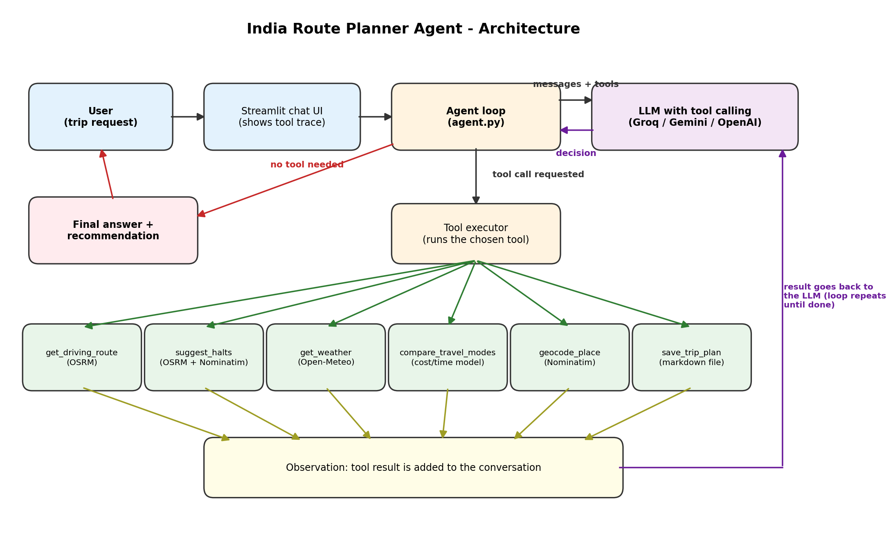
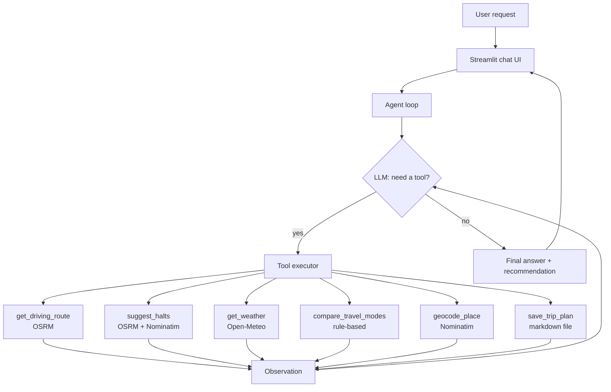

# 🧭 India Route Planner Agent

An **agentic AI** that plans trips between places in India. The LLM decides on its own which tools to call
(routing, halts, weather, mode comparison), reads each result, and loops until it can give a final recommendation.

## Agent schema





## Tools

| Tool | What it does | Data source |
|---|---|---|
| `geocode_place` | Finds coordinates of a place in India | OpenStreetMap Nominatim |
| `get_driving_route` | Road distance and driving time | OSRM public server |
| `suggest_halts` | Break-journey towns every ~150 km | OSRM + Nominatim reverse geocoding |
| `get_weather` | 1-7 day forecast at a place | Open-Meteo (no key) |
| `compare_travel_modes` | Time and cost for car, bus, train, flight | Rule-based estimates |
| `save_trip_plan` | Saves the plan as a `.md` file | Local file |

## Setup

```bash
git clone <your-repo-url>
cd india-route-agent
python -m venv .venv && source .venv/bin/activate   # Windows: .venv\Scripts\activate
pip install -r requirements.txt
cp .env.example .env        # Windows: copy .env.example .env  -> then add your API key
streamlit run app.py
```

## Example prompts

- Plan a trip from Chennai to Coimbatore for 2 people. What's the best way to go?
- I want to drive from Bengaluru to Goa. Suggest halts and tell me the weather there.
- Cheapest way from Delhi to Jaipur for 4 people?

The UI shows an expander under each answer listing every tool call, so you can see the agent's reasoning loop.

## Assumptions and limitations

- Cost and time for `compare_travel_modes` are rough estimates: car 15 km/l at Rs 105/l plus ~Rs 0.8/km tolls,
  average speeds of 50/45/55 km/h for car/bus/train, rail distance about 1.05x road distance.
- No live train or bus availability or fares. Confirm on IRCTC or redBus.
- Free public APIs (Nominatim, OSRM) have rate limits and no uptime guarantee.
- Driving routes only; the OSRM demo server supports the car profile.

## Tech

Python, OpenAI-compatible tool/function calling (works with Groq, Gemini, or OpenAI), Streamlit.
